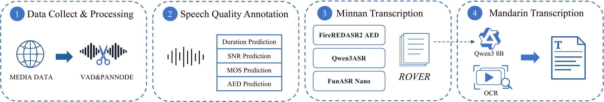
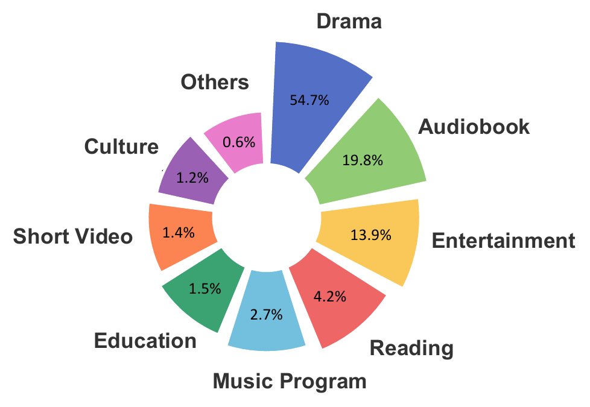
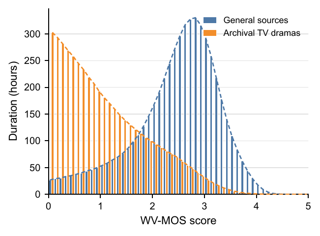
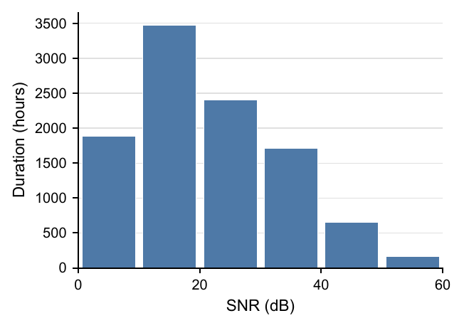
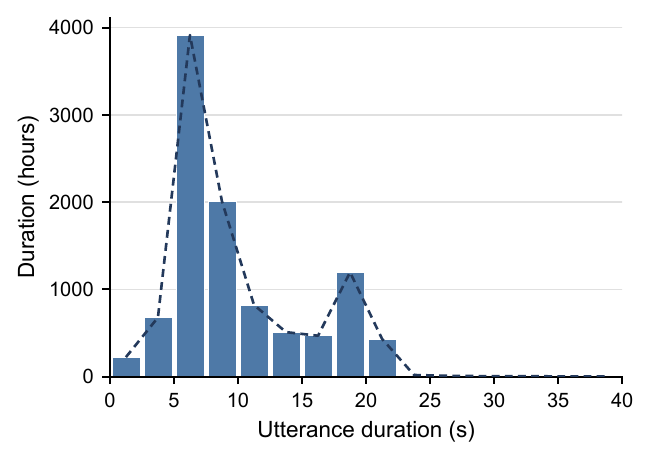

<h1 align="center">WenetSpeech-Min</h1>

<p align="center"><i>A Large-Scale Minnan Speech Corpus with Dual Transcriptions for Dialectal Speech Processing</i></p>

<p align="center">
  Haoyu Zhang<sup>1,*</sup>, Chunjiang He<sup>1,*</sup>, Hongtao Li<sup>2</sup>, Zeyu Zhu<sup>1</sup>, Qituan Shangguan<sup>2</sup>, Chengyou Wang<sup>1</sup>, Jingbin Hu<sup>1</sup>, Ziyu Zhang<sup>1</sup>, Bingshen Mu<sup>1</sup>, Yanbo Wang<sup>3</sup>, Shuai Wang<sup>2,4,8</sup>, Jinhui Ye<sup>4</sup>, Chengdong Liang<sup>4</sup>, Binbin Zhang<sup>4</sup>, Pengcheng Zhu<sup>4</sup>, Chuang Ding<sup>5</sup>, Qiangze Feng<sup>6</sup>, Qingyang Hong<sup>7</sup>, Liumeng Xue<sup>2,8</sup>, Lei Xie<sup>1,†</sup>
</p>

<p align="center"><sub><sup>1</sup> ASLP@NPU, Northwestern Polytechnical University &nbsp;·&nbsp; <sup>2</sup> School of Intelligence Science and Technology, Nanjing University &nbsp;·&nbsp; <sup>3</sup> University of New South Wales &nbsp;·&nbsp; <sup>4</sup> WeNet Open Source Community<br>
<sup>5</sup> Moonstep AI &nbsp;·&nbsp; <sup>6</sup> Nexdata &nbsp;·&nbsp; <sup>7</sup> School of Informatics, Xiamen University &nbsp;·&nbsp; <sup>8</sup> State Key Laboratory of Novel Software Technology, Nanjing University<br>
<sup>*</sup> Equal contribution. &nbsp; <sup>†</sup> Corresponding author.</sub></p>

<p align="center">
  📑 <a href="https://arxiv.org/abs/2609.36834">Paper</a> &nbsp;|&nbsp;
  🐙 <a href="https://github.com/ASLP-lab/WenetSpeech-Min-Repo">GitHub</a> &nbsp;|&nbsp;
  🤗 <a href="https://huggingface.co/collections/ASLP-lab/wenetspeech-min">HuggingFace</a> &nbsp;|&nbsp;
  🎤 <a href="https://aslp-lab.github.io/WenetSpeech-Min-Repo/">Demo Page</a> &nbsp;|&nbsp;
  💬 <a href="https://github.com/ASLP-lab/WenetSpeech-Wu-Repo?tab=readme-ov-file#contact">Contact Us</a>
</p>

<p align="center"></p>

## Overview

WenetSpeech-Min is an open-source, large-scale Minnan speech corpus collected from diverse online media. It contains approximately **10,000 hours** of real-world speech in **5,121,249 utterances**. Every utterance is paired with a Minnan transcript and a Mandarin transcript, enabling both dialect-preserving recognition and readable Mandarin-output recognition.

The release also provides reproducible benchmarks for paired-transcript ASR and Minnan TTS, together with models trained on WenetSpeech-Min.

- **Real-world, multi-source speech:** broad coverage of speaking styles, domains, and acoustic conditions.
- **Dual transcriptions:** Minnan preserves dialectal wording; Mandarin offers a complementary written-Mandarin rendering of the same speech.
- **Public benchmarks:** manually verified evaluation data for Minnan ASR, Mandarin ASR, and Minnan TTS.

## Download

| Resource | Link |
| --- | --- |
| WenetSpeech-Min dataset | [Hugging Face](https://huggingface.co/datasets/ASLP-lab/WS-Min) |
| WenetSpeech-Min benchmarks | [Hugging Face](https://huggingface.co/datasets/ASLP-lab/WS-Min-Bench) |
| ASR models | [Hugging Face](https://huggingface.co/ASLP-lab/WS-Min-ASR) |
| TTS model | [Hugging Face](https://huggingface.co/ASLP-lab/WS-MIN-TTS) |

## WenetSpeech-Min Overview

### Data Construction Pipeline

<p align="center"></p>

The construction pipeline has two stages: audio processing, followed by paired-transcript generation.

1. **Data collection and segmentation.** We collect Minnan speech from heterogeneous online media and use voice activity detection and speaker diarization to produce utterance-level segments.
2. **Speech-quality annotation.** Each segment is characterized by duration, SNR, WV-MOS, and audio-event confidence. Segments with unreliable content or quality are filtered, and speaker-count metadata is retained.
3. **Minnan transcription.** Fine-tuned FireRedASR2-AED, Qwen3-ASR, and FunASR-Nano generate complementary hypotheses. ROVER combines them into a Minnan transcript.
4. **Mandarin transcription.** For media with embedded subtitles, OCR-extracted and normalized subtitles are used. Otherwise, a Qwen3-8B model fine-tuned with LoRA translates the Minnan transcript into Mandarin. Consistency checks then validate each audio–text pair.

### Dataset

WenetSpeech-Min covers roughly 10,000 hours of speech. The mean utterance duration is **7.24 s**; the median lies in the **5–7.5 s** range. About 8,500 hours have recorded source provenance: drama accounts for **54.7%**, audiobook **19.8%**, and entertainment **13.9%** of those sourced hours.

The corpus intentionally retains both relatively clean speech and challenging archival television material. This preserves natural multi-speaker interaction, emotional delivery, and a broad range of real recording conditions.

<table align="center">
  <tr>
    <td align="center"><br><sub>Content-domain distribution</sub></td>
    <td align="center"><br><sub>WV-MOS distribution</sub></td>
  </tr>
  <tr>
    <td align="center"><br><sub>SNR distribution</sub></td>
    <td align="center"><br><sub>Utterance-duration distribution</sub></td>
  </tr>
</table>

For the released utterances, **73.8%** of total duration has SNR between **10 and 40 dB**; the duration-weighted mean SNR is **21.3 dB**. The duration distribution is dominated by short utterances, with a secondary peak near 20 seconds from pre-segmented source clips.

## Benchmarks

### ASR Benchmark: WS-Min-Eval-ASR

WS-Min-Eval-ASR is a **6-hour paired-transcript** benchmark. Every evaluation utterance has manually verified Minnan and Mandarin references, so dialect-transcription and Mandarin-transcription ASR are evaluated on exactly the same audio under a unified normalization and scoring protocol.

| Task | Metrics |
| --- | --- |
| Minnan transcription | Dialect character error rate (D-CER ↓) |
| Mandarin transcription | Mandarin BLEU (M-BLEU ↑) and Mandarin character error rate (M-CER ↓) |

### TTS Benchmark: WS-Min-Eval-TTS

WS-Min-Eval-TTS contains expert-verified Minnan texts, generated with an LLM and refined for naturalness and dialect authenticity. It includes nine high-quality Minnan reference speakers.

| Split | Utterances | Content |
| --- | ---: | --- |
| Easy | 500 | Everyday utterances |
| Hard | 250 | 46 long-form texts, 189 repetition-heavy texts, and 15 tongue twisters |

Objective intelligibility is measured with CER from Qwen3-ASR-WSM-Min transcriptions, and speaker similarity (SIM) uses cosine similarity between WavLM embeddings. Twenty-three native Minnan listeners provide subjective intelligibility (I-MOS), speaker similarity (S-MOS), and accent authenticity (A-MOS) scores on 40 randomly selected cases.

## ASR Leaderboard

Results below follow the paper's evaluation protocol. Lower is better for D-CER and M-CER; higher is better for M-BLEU. † indicates a commercial API.

### Minnan Transcription on WS-Min-Eval-ASR

| Model | D-CER (%) ↓ |
| --- | ---: |
| Hy-ASR-3.0-Preview† | 32.78 |
| CN-MultiDialect-ASR | 18.59 |
| Qwen3-ASR | 34.61 |
| Qwen3-ASR-WSM-Min | 17.59 |
| **Qwen3-ASR-WSM-Min + internal data** | **15.21** |
| FireRedASR2-AED | 43.39 |
| FireRedASR2-AED-WSM | 18.95 |

### Mandarin Transcription

| Model | WS-Min M-BLEU ↑ | WS-Min M-CER ↓ | GigaSpeechBench M-BLEU ↑ | GigaSpeechBench M-CER ↓ | MinSpeech M-BLEU ↑ | MinSpeech M-CER ↓ | Avg. M-BLEU ↑ | Avg. M-CER ↓ |
| --- | ---: | ---: | ---: | ---: | ---: | ---: | ---: | ---: |
| FunASR-Realtime† | 39.09 | 45.41 | 53.37 | 32.62 | 28.22 | 63.23 | 40.23 | 47.09 |
| SeedASR2.0† | 38.91 | 47.58 | 55.32 | 32.50 | **68.53** | **26.21** | **54.25** | 35.43 |
| Qwen3-ASR-MinSpeech | 20.34 | 60.57 | 12.39 | 71.26 | 67.94 | 23.93 | 33.56 | 51.92 |
| Qwen3-ASR-WSM-Mandarin | 42.93 | 42.56 | 51.20 | 34.01 | 59.82 | 29.42 | 51.32 | 35.33 |
| **Qwen3-ASR-WSM-Mandarin + internal data** | **49.39** | **36.81** | 47.65 | 36.66 | 65.69 | 26.21 | 54.24 | **33.05** |
| FireRedASR2-AED | 18.05 | 64.40 | 36.91 | 49.35 | 13.60 | 85.02 | 22.85 | 66.26 |
| FireRedASR2-AED-WSM | 46.06 | 39.53 | **57.73** | **28.61** | 57.73 | 31.85 | 53.73 | 33.33 |

## TTS Leaderboard

Lower CER is better; higher is better for all other metrics. † indicates a commercial API. ‡ denotes a single-fixed-speaker API, for which SIM and S-MOS are not evaluated.

### WS-Min-Eval-TTS Easy

| Model | CER (%) ↓ | SIM ↑ | I-MOS ↑ | S-MOS ↑ | A-MOS ↑ |
| --- | ---: | ---: | ---: | ---: | ---: |
| QwenAudio-3.0-TTS† | **19.90** | 0.672 | 3.88 | **3.85** | 3.62 |
| Qwen3TTS-Flash†‡ | 24.44 | – | **3.93** | – | **3.93** |
| FireRedTTS3 | 33.76 | **0.747** | 3.30 | 3.32 | 3.13 |
| VoxCPM2 | 28.16 | 0.707 | 3.45 | 3.54 | 3.38 |
| MERaLiON-TTS | 21.25 | 0.622 | 3.83 | 3.73 | 3.65 |
| CosyVoice3 | 63.69 | 0.654 | 2.13 | 2.13 | 1.49 |
| CosyVoice3-WSM | 20.26 | 0.678 | 3.85 | 3.75 | 3.65 |

### WS-Min-Eval-TTS Hard

| Model | CER (%) ↓ | SIM ↑ | I-MOS ↑ | S-MOS ↑ | A-MOS ↑ |
| --- | ---: | ---: | ---: | ---: | ---: |
| QwenAudio-3.0-TTS† | **35.09** | 0.685 | **3.75** | 3.73 | 3.70 |
| Qwen3TTS-Flash†‡ | 38.02 | – | **3.75** | – | **3.73** |
| FireRedTTS3 | 55.33 | **0.731** | 3.15 | 3.39 | 3.04 |
| VoxCPM2 | 40.50 | 0.681 | 3.17 | 3.48 | 3.36 |
| MERaLiON-TTS | 37.28 | 0.622 | 3.58 | 3.73 | 3.63 |
| CosyVoice3 | 60.35 | 0.610 | 2.00 | 2.40 | 1.43 |
| CosyVoice3-WSM | 35.98 | 0.669 | 3.65 | **3.85** | 3.70 |


## Contributors

<table align="center">
  <tr>
    <td align="center" width="25%"></td>
    <td align="center" width="25%"></td>
    <td align="center" width="25%"></td>
    <td align="center" width="25%"></td>
  </tr>
  <tr>
    <td align="center" width="25%"></td>
    <td align="center" width="25%"></td>
    <td align="center" width="25%"></td>
    <td align="center" width="25%"></td>
  </tr>
</table>

## Citation

```bibtex
@article{zhang2026wenetspeechmin,
  title={WenetSpeech-Min: A Large-Scale Minnan Speech Corpus with Dual Transcriptions for Dialectal Speech Processing},
  author={Zhang, Haoyu and He, Chunjiang and Li, Hongtao and Zhu, Zeyu and Shangguan, Qituan and Wang, Chengyou and Hu, Jingbin and Zhang, Ziyu and Mu, Bingshen and Wang, Yanbo and others},
  journal={arXiv preprint arXiv:2609.36834},
  year={2026}
}
```

## Contact

If you are interested in leaving a message to our research team, feel free to email haoyuz@mail.nwpu.edu.cn or  hechunjiang@mail.nwpu.edu.cn

<p align="center">
  <span style="display: inline-block; margin-right: 10px;">
    
  </span>
   <span style="display: inline-block; margin-right: 10px;">
    
  </span>
</p>